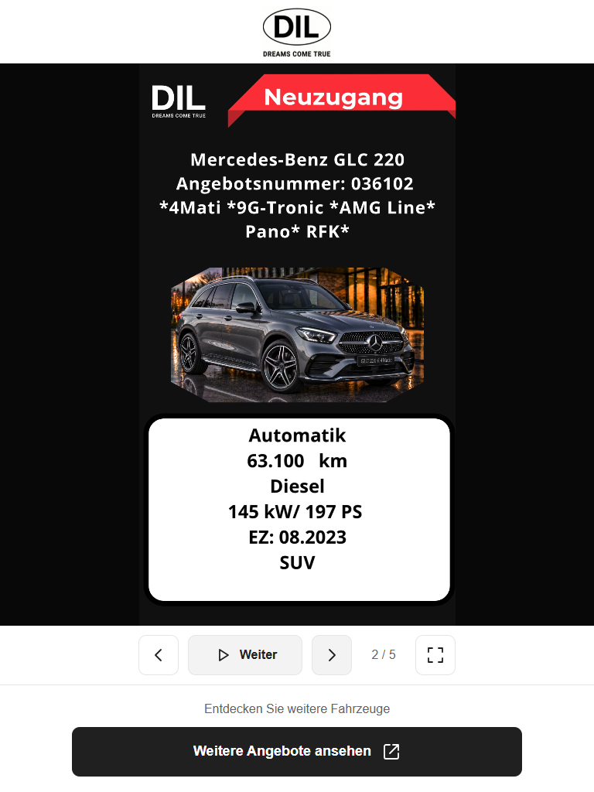

#Digital Signage Player

A browser-based advertising display for a car dealership, designed for portrait screens and touch controls. It presents a repeating sequence of videos and images, with a German interface and one JSON playlist.

**Application name:** Autohaus DIL — Digitales Werbedisplay  
**Stack:** HTML · CSS · Vanilla JavaScript · Node.js for local tools  
**Demo:** run `npm start`, then open [the local preview](http://localhost:8000).



[Mobile](docs/mobile.png) · [Desktop](docs/desktop.png) · [Landscape](docs/landscape.png)

## The problem

A showroom display needs to rotate promotional content while allowing visitors to pause, browse offers, and open the dealership's vehicle listings. Operators need to replace media without rebuilding the application.

This project addresses that workflow with a static website and a JSON content list. It handles browser autoplay restrictions, interrupted playback, missing media, and reduced-motion preferences.

## Project scope and contribution

The frontend implementation covers the responsive player, video and image lifecycle management, playlist validation, loading and error states, keyboard behavior, and automated logic checks.

The portfolio preparation includes separating HTML, styles, and player logic; extracting the embedded logo; removing the duplicate fallback playlist; fixing playback icon visibility; and documenting browser checks with screenshots. This refactoring and documentation work was assisted by OpenAI Codex. The dealership branding and promotional videos are supplied project assets, separate from the player implementation.

## Technical decisions

| Decision                            | Reason and tradeoff                                                                                                                 |
| ----------------------------------- | ----------------------------------------------------------------------------------------------------------------------------------- |
| Vanilla JavaScript and static files | Simple deployment without a runtime framework or build pipeline.                                                                    |
| One playlist file                   | Hosted mode reads media/playlist.json. Direct-file mode imports that JSON explicitly because browsers restrict local file fetching. |
| Media session IDs                   | Ignore callbacks from previous media when visitors navigate quickly.                                                                |
| Preserve pause state                | Videos retain their position; images retain their remaining display time.                                                           |
| Contain the media within its frame  | Keeps the full advertisement visible. Different media and screen ratios produce black margins.                                      |
| Reduced-motion and keyboard pause   | Gives visitors control over automatic rotation.                                                                                     |
| Separate logo asset                 | Makes HTML small and readable and allows independent image caching on a production host.                                            |

## Features

- Repeating video/image playlist, previous/next controls, and offer counter.
- Pause/resume, muted autoplay, and manual start when autoplay is blocked.
- Fullscreen toggle where supported.
- Touch controls, visible focus, German accessible labels, and status messages.
- Pauses when the page is hidden, when opening the offers link, and when pressing Tab.
- Loading timeouts, retries, and recovery from missing media.
- Hosted playlist checks every 60 seconds; changes wait while an existing playlist is paused.
- Complete validation before a local import replaces a working playlist.

## Quick start

With Node.js installed, run from the project folder:

```sh
npm start
```

No package installation or build step is needed. Open [http://localhost:8000](http://localhost:8000). Stop with **Ctrl+C**. If PowerShell blocks npm.ps1, use `npm.cmd start`.

The preview server binds only to the local computer and supports video byte-range requests. It is a development utility; use a static web host for production.

Alternatively, open index.html directly, click **Wiedergabeliste**, and select media/playlist.json. This import lasts for the page session. Paths always resolve against the project's media/ folder, regardless of where the selected JSON is stored. There is no embedded fallback playlist.

## Project structure

```text
index.html             German page structure and metadata
assets/
  styles.css           Responsive styles and control states
  player.js            Playback, validation, and browser events
  logo.jpg             Original logo extracted from the HTML
media/
  playlist.json        Playback order and media settings
  Fernseher.mp4         Landscape campaign video
  1.mp4 ... 4.mp4      Portrait vehicle advertisements
docs/
  portrait.png         Tablet portrait screenshot
  mobile.png           Small-screen screenshot
  desktop.png          Desktop screenshot
  landscape.png        Landscape screenshot
  local-mode.png       Local playlist control on a small screen
  media-review.png     Sample frames from the five videos
  PRUEFUNG.md          Verification record (German)
ANLEITUNG.txt          German operator instructions
serve.cjs              Local static preview server
verify-player.cjs      Dependency-free player logic checks
package.json           Preview and test commands
README.md              English portfolio documentation
```

## Configure content

Add files to media/ and edit media/playlist.json. Entries play in array order and repeat after the last entry.

```json
[
  { "file": "Fernseher.mp4", "type": "video" },
  {
    "file": "angebot.jpg",
    "type": "image",
    "seconds": 10,
    "alt": "Aktuelles Fahrzeugangebot von Autohaus DIL"
  }
]
```

The example image angebot.jpg must be added before using that entry.

| Field   | Meaning                                                                                        |
| ------- | ---------------------------------------------------------------------------------------------- |
| file    | Required path relative to media/. Match filename capitalization.                               |
| type    | video or image. Without it, .mp4 and .webm are detected as videos; other extensions as images. |
| seconds | Image duration, default 10 seconds, constrained to 3–300 seconds. Videos play until they end.  |
| alt     | German image description for screen readers.                                                   |

Use new filenames when replacing media to avoid stale browser caches. In direct-file mode, import the updated JSON again. Keep technical JSON keys and values unchanged; write visitor-facing copy in German.

The supplied videos are sample content, including a dated campaign, and are not a live inventory feed. Sampled frames contain German advertising copy; the original “Dreams Come True” brand slogan and product names are preserved.

## Verification

```sh
npm test
```

Simulated checks cover syntax, pause/resume, navigation and wrapping, page visibility, offer-link suspension, keyboard pause, stale events, retries, reduced motion, blocked autoplay, image timing, empty playlists, network errors, local imports, invalid-import recovery, SVG icon states, link attributes, unique IDs, and media-file existence.

See [the verification record](docs/PRUEFUNG.md) for real-browser checks and their limits. Screenshots show the actual application. Physical showroom hardware and other browser engines still need device testing.

## Static deployment

Deploy index.html, assets/, and media/ together, preserving the directory structure. A domain root or subdirectory works. Serve the files over HTTPS. The preview server, tests, and documentation are not needed at runtime.

## Asset attribution

Autohaus DIL branding and included advertising media are supplied project assets. No asset-reuse license is included. This documentation describes the player implementation without claiming authorship of the logo, vehicles, or promotional artwork.
